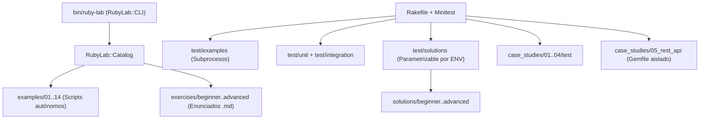

# Arquitectura del Repositorio

**Ruby Practical Lab** está diseñado con una separación estricta entre la herramienta de navegación (`lib/ruby_lab`), el material didáctico (`examples/`, `exercises/`, `solutions/`) y las aplicaciones de ejemplo (`case_studies/`).

## Diagrama general de componentes

## 1. Núcleo del laboratorio (`lib/ruby_lab/`)

- [`lib/ruby_lab.rb`](../lib/ruby_lab.rb): punto de entrada que expone `RubyLab.root`.
- [`lib/ruby_lab/catalog.rb`](../lib/ruby_lab/catalog.rb): descubre dinámicamente los módulos, ejemplos y ejercicios leyendo el sistema de archivos con `Enumerator::Lazy`. No mantiene listas estáticas: añadir un archivo con el formato `# = Título` lo incorpora automáticamente al catálogo.
- [`lib/ruby_lab/cli.rb`](../lib/ruby_lab/cli.rb): interfaz de línea de comandos con inyección de dependencias (`out:`, `err:`, `catalog:`, `runner:`) que devuelve códigos de salida explícitos (`0` o `1`) en lugar de invocar `Kernel#exit` directamente.

## 2. Separación entre ejercicios, soluciones y pruebas

- Los enunciados en `exercises/` son documentos Markdown puros sin código de solución.
- Las soluciones en `solutions/` son módulos autocontenidos bajo `Solutions::<Nivel>::<Ejercicio>` y cuentan con un bloque `if $PROGRAM_NAME == __FILE__` al final para poder ejecutarse directamente con `ruby`.
- `TestSupport.require_solution` en [`test/test_helper.rb`](../test/test_helper.rb) lee la variable de entorno `RUBY_LAB_SOLUTIONS_DIR` (por defecto `"solutions"`), permitiendo validar implementaciones alternativas con la misma suite de pruebas.

## 3. Arquitectura en capas de los Casos de Estudio (`case_studies/`)

Cada caso de estudio aplica separación de responsabilidades sin caer en sobreingeniería:

1. **Entidades y objetos de valor**: clases o estructuras inmutables (`Data.define`) que validan sus propios invariantes en el momento de crearse y almacenan importes monetarios en centavos (`Integer`).
2. **Servicios o políticas de dominio**: coordinan las reglas de negocio (por ejemplo, `Ledger`, `InventoryService`, `TransitionPolicy`, `Analyzer`, `TicketService`) sin depender de `gets`/`puts` ni de rutas de disco fijas.
3. **Adaptadores de persistencia e intercambio**: repositorios JSON con escritura atómica (`Tempfile` + `FileUtils.mv`) y exportadores CSV.
4. **Adaptadores de entrada**: interfaces CLI (`OptionParser`) en los casos 01–04 y aplicación HTTP Rack/Sinatra (`RestApi::App`) en el caso 05.

## 4. Aislamiento de dependencias

- El `Gemfile` raíz declara únicamente las gemas *bundled* de la biblioteca estándar (`csv`, `logger`, `benchmark`) y las herramientas de verificación (`minitest`, `rake`, `rubocop`).
- El Caso de Estudio 05 (`case_studies/05_rest_api/`) cuenta con su propio `Gemfile` para aislar `sinatra`, `rackup`, `puma` y `rack-test` del resto del laboratorio.

